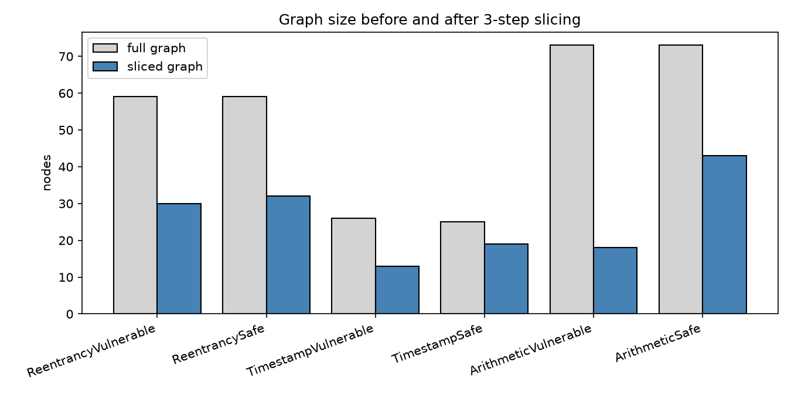
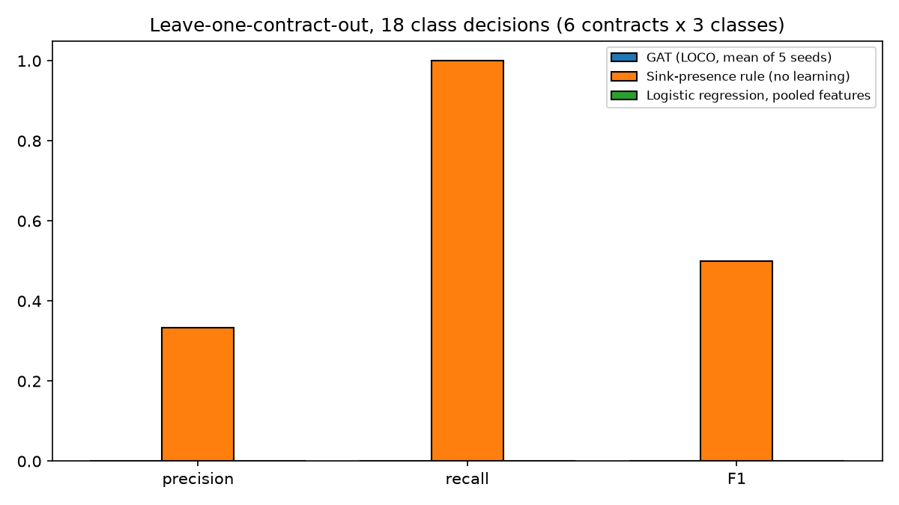
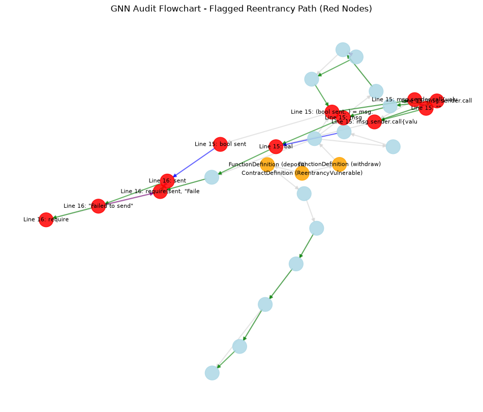

# Graph-Based Smart Contract Auditing: A Leave-One-Contract-Out Evaluation of a Graph Attention Network Prototype

**Caleb Ablorh-Adjei** · Student ID **22186668**  
Final project report · October 2026  
Repository: <https://github.com/dcablorh/computanional-methods>

## Abstract

Smart contracts on public blockchains are immutable once deployed, so a code-level flaw can cause irreversible loss. We present a pre-deployment auditing prototype for Solidity. It compiles a contract, builds a multi-relational graph from its abstract syntax tree, control-flow graph and data-flow edges, slices the graph around security-relevant statements, and classifies it with a Graph Attention Network (GAT). The model gives a contract-level verdict and a node-level score that points to lines. The prototype covers three vulnerability classes: Reentrancy, Timestamp Dependency and Arithmetic Error. We evaluate it on six hand-written demo contracts, one vulnerable and one safe per class. The model fits its training contracts (18 of 18 class decisions correct). Under leave-one-contract-out evaluation it flags none of the three held-out vulnerable contracts (recall 0.000). A rule that flags any contract containing the relevant sink reaches recall 1.000, with precision 0.333. On six further contracts written after the first results, the trained model detects all three vulnerable contracts with no false positives. That test was used to diagnose a defect, so it is not an independent result. We found and fixed three code defects: two training labels that pointed at the wrong lines, an arithmetic-operator lookup that failed for legacy syntax trees, and an arithmetic check that ignored compound assignments. The fix improved the new-contract result but weakened separation on the demo set. The pipeline runs end to end. Generalization is not yet demonstrated, and a larger labelled benchmark is needed before any detection claim can be made.

**Keywords:** smart contracts; Solidity; graph attention network; program slicing; vulnerability detection; leave-one-out evaluation

## 1. Introduction

Smart contracts are programs that hold and move digital assets on blockchains such as Ethereum. Once deployed, the code cannot be patched, so a flaw can be exploited before its owner notices (Zheng et al., 2020). Three classes of flaw illustrate the stakes. Reentrancy lets a callee re-enter a function before the caller updates its state; this is the mechanism behind the 2016 TheDAO loss (Luu et al., 2016). Timestamp dependence lets a miner influence logic that relies on `block.timestamp`. Arithmetic errors wrap integers silently in pre-0.8 Solidity.

Automated tools address these flaws with symbolic execution, pattern matching or static analysis. Oyente runs symbolic execution on bytecode (Luu et al., 2016), SmartCheck checks Solidity source with extensible rules (Tikhomirov et al., 2018), and Slither lifts Solidity into an SSA intermediate representation (Feist et al., 2019). A large empirical review found that these tools disagree with each other, and that a high share of real contracts is flagged (Durieux et al., 2020). Learning-based detectors have been proposed as a way to reduce false alarms (De Baets et al., 2024), and graph neural networks are a common choice because a contract's control and data flow is naturally a graph (Zhuang et al., 2020; Liu et al., 2023).

This project builds such a detector and asks three questions.

- **RQ1.** Can a GAT over a sliced contract graph learn to separate vulnerable from safe contracts for the three classes?
- **RQ2.** Does it generalize to contracts it has not seen, and how does it compare with simple baselines under the same protocol?
- **RQ3.** Can its node-level scores localize the vulnerable line?

The contribution is the working pipeline, a leave-one-contract-out protocol with two baselines, an external test on new contracts, a documented set of defects found and fixed during the work, and a negative result on generalization at this scale. We do not claim a detection rate.

## 2. Related work

**Graph attention.** The GAT layer computes attention coefficients over a node's neighbours and aggregates their features with those weights (Veličković et al., 2018). Graph convolution with a first-order spectral approximation is the simpler alternative (Kipf & Welling, 2017). The classifier here uses the GAT form.

**Graph-based contract detection.** Zhuang et al. (2020) build a graph of each function's syntactic and semantic structure, reduce it with an elimination step and apply a graph convolution with temporal message propagation. Liu et al. (2023) model contracts as a nested multi-relational graph of functions and localize vulnerable functions. Nguyen et al. (2022) use heterogeneous graph embeddings with metapaths for fine-grained detection. These methods are trained and tested on large corpora. The present work uses six training contracts and is therefore a feasibility study.

**Tool evaluation.** Durieux et al. (2020) ran nine tools on 47,518 contracts and 69 annotated vulnerable contracts, and reported low agreement between tools and a high flag rate on real contracts. Ghaleb and Pattabiraman (2020) evaluated six tools by injecting bugs into contracts (SolidiFI). SolidiFI and the SmartBugs collection are natural held-out benchmarks for future work (Section 8). Sayeed et al. (2020) reviewed attacks and reported that the tools they tested still contain known flaws.

The earlier draft of this work cited six further papers that could not be verified against a publisher or arXiv record. They were removed. The verified literature is listed in `LITERATURE_MATRIX.md` in the repository.

## 3. Data and ethics

The training data are six Solidity files written for this project (Table 1). Each vulnerable file contains one minimal instance of its pattern. Each safe file is a counterpart with the pattern removed or fixed: a state update before the external call for Reentrancy, no timestamp dependence for Timestamp, and Solidity 0.8 (checked arithmetic) for Arithmetic. The Timestamp safe file is not a line-for-line variant of the vulnerable one.

The external test set is six further files, written after the first results and kept separate (Table 4). They use different names, layouts and, for one vulnerable file, Solidity 0.7.6. Labels are the author's annotations, checked by reading each file. The data card is `DATA_CARD.md`.

No human subjects, personal data, secrets or live-network queries are involved. The vulnerable examples are the classic public patterns in minimal form and contain no working exploit. The ethics statement is `ETHICS.md`.

| Contract                 | Compiler | Class      | Label      | Vulnerable line(s) |
|--------------------------|----------|------------|------------|--------------------|
| ReentrancyVulnerable.sol | 0.8.x    | Reentrancy | vulnerable | 15, 16             |
| ReentrancySafe.sol       | 0.8.x    | Reentrancy | safe       | none               |
| TimestampVulnerable.sol  | 0.8.x    | Timestamp  | vulnerable | 9                  |
| TimestampSafe.sol        | 0.8.x    | Timestamp  | safe       | none               |
| ArithmeticVulnerable.sol | 0.7.6    | Arithmetic | vulnerable | 12                 |
| ArithmeticSafe.sol       | 0.8.x    | Arithmetic | safe       | none               |

**Table 1.** Demo (training) contracts and labels. Line numbers were checked against the files.

## 4. Method

### 4.1 Graph construction

The compiler wrapper (`parser/compiler.py`) reads the pragma, selects a solc version (0.7.6 or 0.8.20 in these experiments) and returns the AST. The graph builder (`parser/graph_builder.py`) creates a node for each AST node with its line and source text, an AST edge for each parent-child pair, control-flow edges from a statement walk, and data-flow edges from identifier references, assignments, declarations and call arguments. Both the legacy AST (solc 0.7.x, nodes labelled by `name` with children in `children`) and the compact AST (solc 0.8.x, `nodeType` with named fields) are handled.

### 4.2 Slicing

Interest points are external calls (`.call`, `transfer`, `send`), references to `block.timestamp` or `now`, and arithmetic operations. Arithmetic operations are binary operators and compound assignments (`+=`, `-=`, `*=`, `/=`); the compound forms were added after the external test (Section 6). From each interest point, the slicer follows control and data edges forward and backward for three steps, then adds up to three AST ancestors so the slice remains a connected tree (`slicing/slicer.py`). If a contract has no interest point, the seeds are function calls and variable declarations.

### 4.3 Model

Each node has a 25-dimensional feature vector: a one-hot code for its AST type over 20 types plus an "other" bin, and four keyword flags (call, timestamp, arithmetic, state write). The arithmetic flag is set for binary operators and for compound assignments. Two GAT layers with hidden size 64 and a dropout of 0.1 produce node embeddings. A node head gives three per-class logits. A graph head applies to the mean of the node embeddings and gives three per-class logits. The graph loss is binary cross-entropy on the graph head, plus twice the same loss on the node head.

Training uses Adam with learning rate 0.005 and weight decay 1e-4, for 100 epochs with one optimizer step per graph. The seed is 42 for the saved weights. A class is flagged when its graph probability exceeds 0.5. A line is localized when a node in that line has a class probability above 0.3. Both thresholds were set by hand and were not tuned.

### 4.4 Evaluation protocols

With six contracts, a random split would leave no test positive for some classes. We use two protocols.

**Leave-one-contract-out (LOCO).** For each held-out demo contract, the GAT is retrained on the other five and produces a verdict for each of the three classes. This gives 18 binary decisions per method (6 contracts × 3 classes), of which 3 are positive. The GAT is run with five seeds (0 to 4).

**External test.** The GAT is trained on all six demo contracts (five seeds) and scored on the six external contracts. This gives 18 decisions, of which 3 are positive. It asks whether the trained model recognizes new contracts that share patterns with the training set. It is not independent of the work: the arithmetic fix in Section 6 was made after the first look at one of these contracts.

Two baselines use the same folds and contracts:

- **Sink-presence rule.** Flags a class whenever the full graph contains any sink for it. It uses the same keywords as the slicer and needs no training. It is the simplest rule that tests whether the learned model adds anything.
- **Logistic regression** on the mean and maximum of the 25 node features over the sliced graph (50 values). It uses pooled features with no message passing, and tests whether graph structure is needed.

## 5. Results

### 5.1 Graph size after slicing

Table 2 lists node counts before and after slicing, after the arithmetic fix. Compound assignments add seeds, so the slices of the arithmetic contracts are larger than before the fix. For the vulnerable arithmetic contract the slice keeps 18 nodes (75.3% reduction). For the safe arithmetic contract it keeps 43 (41.1%).

| Contract                 | Full graph | Sliced graph | Reduction |
|--------------------------|------------|--------------|-----------|
| ReentrancyVulnerable.sol | 59         | 30           | 49.2%     |
| ReentrancySafe.sol       | 59         | 32           | 45.8%     |
| TimestampVulnerable.sol  | 26         | 13           | 50.0%     |
| TimestampSafe.sol        | 25         | 19           | 24.0%     |
| ArithmeticVulnerable.sol | 73         | 18           | 75.3%     |
| ArithmeticSafe.sol       | 73         | 43           | 41.1%     |

**Table 2.** Nodes before and after the 3-step slice, with the arithmetic fix (`results/slicing_sizes.csv`).

*Figure 1. Node counts before and after slicing for the six demo contracts.*
### 5.2 In-sample fit

Trained on all six demo contracts, the saved model gives 18 of 18 correct decisions (precision, recall and F1 all 1.000). Its confidences for the vulnerable contracts are 58.29% (Reentrancy), 99.92% (Timestamp) and 99.88% (Arithmetic). Before the arithmetic fix, the Reentrancy confidence was 99.21%. The highest confidence for any safe contract is now 28.82% (TimestampSafe.sol, Timestamp class), and it was 0.37% before the fix. The separation between classes on the demo set is therefore weaker than before the fix. The in-sample result shows that the classifier can fit its training data. It says nothing about unseen contracts.

### 5.3 Leave-one-contract-out comparison

Table 3 gives the LOCO result. The GAT produced the same decisions for all five seeds, so its standard deviation is zero.

| Method                         | TP  | FP  | TN  | FN  | Precision | Recall | F1    | Accuracy |
|--------------------------------|-----|-----|-----|-----|-----------|--------|-------|----------|
| GAT (5 seeds, identical)       | 0   | 1   | 14  | 3   | 0.000     | 0.000  | 0.000 | 0.778    |
| Sink-presence rule             | 3   | 6   | 9   | 0   | 0.333     | 1.000  | 0.500 | 0.667    |
| Logistic regression            | 0   | 0   | 15  | 3   | 0.000     | 0.000  | 0.000 | 0.833    |
| GAT, in-sample (saved weights) | 3   | 0   | 15  | 0   | 1.000     | 1.000  | 1.000 | 1.000    |

**Table 3.** Leave-one-contract-out results, 18 class decisions per method (3 positive). Source: `results/metrics.json`.

The GAT never flags a held-out vulnerable contract. Its accuracy of 0.778 comes mostly from predicting "safe" on decisions that are safe. The sink-presence rule has perfect recall, but after the arithmetic fix it also flags every contract that contains an arithmetic operation, which gives six false positives. Logistic regression predicts "safe" for every decision, so its accuracy of 0.833 reflects the class imbalance and not detection.

*Figure 2. Leave-one-contract-out precision, recall and F1 for the three methods (18 decisions each).*
### 5.4 Node-level localization

For the saved, in-sample model, the auditor localizes Reentrancy to lines 15 and 16 (Figure 3), which are the external call and its result check. The Timestamp contract is localized to line 9, the `require` on `block.timestamp`. The Arithmetic contract is flagged at 99.88% but no line exceeds the 0.3 node threshold, so the auditor reports that it cannot localize it.

Under leave-one-contract-out, localization fails in all 15 vulnerable-contract evaluations (3 contracts × 5 seeds): no node reaches the threshold for the held-out contract's class. Mean precision and recall are both 0.000.

*Figure 3. Output of `auditor.py --visualize` for ReentrancyVulnerable.sol (saved weights). Red nodes exceed the 0.3 threshold for the Reentrancy class and correspond to lines 15 and 16. Node positions use a spring layout with a fixed seed.*
### 5.5 External test on six new contracts

Table 4 gives the external result. The "before" column is the same test before the arithmetic fix (`results/logs/before_arithmetic_fix/`).

| Method | Precision | Recall | F1 | Accuracy | Precision (before fix) | Recall (before fix) |
|----|----|----|----|----|----|----|
| GAT | 1.000 | 1.000 | 1.000 | 1.000 | 1.000 | 0.667 |
| Sink-presence rule | 0.300 | 1.000 | 0.462 | 0.611 | 0.400 | 0.667 |
| Logistic regression | 0.000 | 0.000 | 0.000 | 0.833 | 0.000 | 0.000 |

**Table 4.** External test: six new contracts, 18 decisions, 3 positive. Mean of five seeds for the GAT.

The trained GAT assigns 0.974 to `VaultVulnerable.sol` (Reentrancy), 0.931 to `RaffleVulnerable.sol` (Timestamp) and 0.999 to `LedgerVulnerable.sol` (Arithmetic). Its highest score on a safe external contract is 0.018. Before the arithmetic fix, the GAT missed the Ledger contract with probability 0.000 in every seed. It found the other two.

Localization on the external vulnerable contracts has mean precision 0.489 and mean recall 0.667 over 15 evaluations. The vault is localized exactly (lines 14 and 15). The raffle is localized to lines 13 and 14, where line 14 is the assignment after the flagged check, which gives precision 0.5. The ledger is not localized.

**Independence.** This test is not a clean held-out result. The arithmetic defect in Section 6 was found by looking at `LedgerVulnerable.sol`, and the fix was made to pass it. A fresh test set is needed to check the fix.

## 6. Error analysis and defects

Table 5 lists the LOCO errors with the reason we found for each.

| Method | Contract and class | Error | Cause |
|----|----|----|----|
| GAT (all seeds) | ReentrancyVulnerable, Reentrancy | FN, probability ~4e-6 (seed 0) | When it is held out, the only Reentrancy training example is the safe contract. A single negative example likely teaches the model to score this pattern as safe. |
| GAT (all seeds) | ReentrancySafe, Reentrancy | FP, probability 0.96 (seed 0) | When it is held out, the only positive example is the vulnerable contract. Both contain the same external call, so a likely cause is that the model keys on the call and not on its position relative to the state update. We did not test this. |
| GAT (all seeds) | TimestampVulnerable, Timestamp | FN in all seeds | The only timestamp positive is held out; the training fold has only the safe timestamp contract. |
| GAT (all seeds) | ArithmeticVulnerable, Arithmetic | FN in all seeds | The same single-example problem. The slice has 18 nodes, and no node is scored above 0.3. |
| Sink rule | ReentrancySafe, Reentrancy | FP | The contract contains a real external call, and the rule does not consider that the state is updated first. |
| Sink rule | Reentrancy class on ArithmeticVulnerable and ArithmeticSafe | FP (both) | The trigger is the substring `send` in `msg.sender` or `"Failed to send"`. This is the keyword problem in Section 8. |
| Sink rule | Arithmetic class on ReentrancyVulnerable, ReentrancySafe and ArithmeticSafe | FP (three) | After the fix, any `+=`, `-=`, `*` or `+` is an arithmetic sink. The rule cannot tell a checked operation from an unchecked one. |

**Table 5.** LOCO errors and their causes.

The sink rule's false positives after the fix show the cost of the arithmetic change. The rule now flags almost every contract with arithmetic, and the GAT's slices grow for the same reason (Table 2).

### 6.1 Defects found and fixed

1.  **Training labels for two contracts pointed at the wrong lines** (Timestamp line 10 and Arithmetic line 14, instead of 9 and 12).
2.  **Legacy-AST operator lookup** failed for solc 0.7.6, so the arithmetic contract had no arithmetic sink.
3.  **Compound assignments were invisible to the arithmetic check.** `+=`, `-=`, `*=` and `/=` are `Assignment` nodes, and the sink check and feature looked only at binary operators. This was found on the external test (LedgerVulnerable.sol, an unchecked `-=`). The fix made the new contract detectable. It also raised the in-sample Reentrancy confidence to 58.29% (from 99.21%), raised safe-contract scores on Timestamp (up to 28.82%), and enlarged the arithmetic slices.

Pre-fix logs are kept in `results/logs/before_fixes/` and `results/logs/before_arithmetic_fix/`. The full list is in `FAILURE_LOG.md`.

## 7. Discussion

**RQ1 (fit).** The GAT learns its six training contracts. After the arithmetic fix it does so with a weaker margin for Reentrancy. The question is what it learned, not whether it can fit.

**RQ2 (generalization).** The two protocols give different answers, and the difference is structural. Under LOCO, holding out a contract removes the only example of its class, and the model then has to generalize from one example. It does not do so: recall is 0. On the external test, every class has a training example, and the model detects the new vulnerable contracts that share a pattern with one (Reentrancy and Timestamp before the fix, Arithmetic after it). This suggests the model recognizes patterns it has seen, not the general vulnerability. The external result is also not independent, because one contract was used to choose the fix. We therefore cannot say that the approach generalizes, and the honest reading is that it works on contracts that resemble its training data.

**RQ3 (localization).** Localization works in-sample for Reentrancy and Timestamp, and partly on the external test (the vault exactly, the raffle with one extra line). It fails under LOCO in every fold. The node scores depend on the same class signal that the classifier needs, so localization inherits the same limits.

**What the defects show.** The label offsets and the legacy operator lookup survive an in-sample check, because that check reuses the same labels and graphs. The compound-assignment gap was visible only on a contract that the model had not seen. This supports keeping a held-out test, and it argues against tuning on that test. We did not test whether the arithmetic fix is correct beyond the contracts in this report.

## 8. Limitations

1.  **Small data.** Six training contracts, six external contracts, and three positive decisions in each evaluation. One decision changes recall by 0.33 on the external test.
2.  **Authors' own contracts.** The training and external contracts were all written by the author, in similar styles. They are not real deployed code, so they cannot show performance on real code.
3.  **Test used for diagnosis.** The external test informed the arithmetic fix, so its result is optimistic. A new untouched test set is needed.
4.  **Keyword features.** Flags are set by substring matches. `"now"` matches inside words such as *know*, and `"send"` matches inside `msg.sender`. The sink-rule errors above show these substrings produce false signals. An ablation to measure their effect on the GAT has not been run.
5.  **Hand-set thresholds.** The 0.5 graph and 0.3 node thresholds were not tuned on held-out data.
6.  **Narrow compiler coverage.** Solc 0.7.6 (legacy AST) appears in one training contract and one external contract. Versions 0.4.x to 0.6.x are mapped but untested.
7.  **Only one GNN variant.** The TMP and MRN-GCN variants described in the earlier draft are not implemented.
8.  **No public benchmark.** SmartBugs and SolidiFI are the natural held-out sets (Durieux et al., 2020; Ghaleb & Pattabiraman, 2020). Using them requires a separate decision about downloading them, which was not made for this report.
9.  **No calibration.** The reported confidences are sigmoid outputs and have not been checked against observed frequencies.

## 9. Conclusion

We built and tested a pipeline that turns Solidity contracts into multi-relational graphs, slices them, and classifies them with a GAT. The pipeline runs end to end, and its defects were found and fixed, with the record kept. On the demo contracts the model fits its training data. Under leave-one-contract-out evaluation it does not detect any held-out vulnerable contract, and a fixed sink-presence rule has higher recall. On six external contracts, the trained model finds all three vulnerable contracts after an arithmetic fix made in response to one of them. That result cannot be counted as evidence of generalization, because the test informed the fix.

The plan is therefore partly supported. It works mechanically, and the new-contract result is encouraging, but generalization is not demonstrated. The next step is a fresh test set that is not used for any design decision, followed by the held-out evaluation on SolidiFI and SmartBugs with precision, recall and F1 reported on contracts the model has not seen, and comparison with the tools named in Section 2.

## Reproducibility and AI disclosure

The repository includes the code, the saved weights, four executed notebooks, all metrics and logs, a data card, a model card, a failure log and a reproducibility checklist. All numbers in this report come from files in `results/`. The submitted version is tagged `submission-v1` in the repository (commit before the arithmetic fix). The arithmetic fix and this report are in a later commit. AI assistance was used in the project.

## References

De Baets, C., Suleiman, B., Chitizadeh, A., & Razzak, I. (2024). *Vulnerability detection in smart contracts: A comprehensive survey* [Preprint]. arXiv:2407.07922.

Durieux, T., Ferreira, J. F., Abreu, R., & Cruz, P. (2020). Empirical review of automated analysis tools on 47,587 Ethereum smart contracts. In *Proceedings of the 42nd International Conference on Software Engineering (ICSE 2020)* (pp. 530–541). arXiv:1910.10601.

Feist, J., Grieco, G., & Groce, A. (2019). Slither: A static analysis framework for smart contracts. In *Proceedings of the 2nd International Workshop on Emerging Trends in Software Engineering for Blockchain (WETSEB 2019)*. arXiv:1908.09878.

Ghaleb, A., & Pattabiraman, K. (2020). How effective are smart contract analysis tools? Evaluating smart contract static analysis tools using bug injection. In *Proceedings of the 29th ACM SIGSOFT International Symposium on Software Testing and Analysis (ISSTA 2020)*. arXiv:2005.11613.

Kipf, T. N., & Welling, M. (2017). Semi-supervised classification with graph convolutional networks. In *International Conference on Learning Representations (ICLR 2017)*. arXiv:1609.02907.

Liu, H., Fan, Y., Feng, L., & Wei, Z. (2023). *Vulnerable smart contract function locating based on multi-relational nested graph convolutional network* [Preprint]. arXiv:2306.04479.

Luu, L., Chu, D.-H., Olickel, H., Saxena, P., & Hobor, A. (2016). Making smart contracts smarter. In *Proceedings of the 2016 ACM SIGSAC Conference on Computer and Communications Security (CCS 2016)*. https://doi.org/10.1145/2976749.2978309

Nguyen, H. H., Nguyen, N.-M., Xie, C., Ahmadi, Z., Kudenko, D., Doan, T.-N., & Jiang, L. (2022). *MANDO: Multi-level heterogeneous graph embeddings for fine-grained detection of smart contract vulnerabilities* [Preprint]. arXiv:2208.13252.

Sayeed, S., Marco-Gisbert, H., & Caira, T. (2020). Smart contract: Attacks and protections. *IEEE Access, 8*, 24416–24427. https://doi.org/10.1109/access.2020.2970495

Tikhomirov, S., Voskresenskaya, E., Ivanitskiy, I., Takhaviev, R., Marchenko, E., & Alexandrov, Y. (2018). SmartCheck: Static analysis of Ethereum smart contracts. In *Proceedings of the 1st International Workshop on Emerging Trends in Software Engineering for Blockchain (WETSEB 2018)* (pp. 9–16).

Veličković, P., Cucurull, G., Casanova, A., Romero, A., Liò, P., & Bengio, Y. (2018). Graph attention networks. In *International Conference on Learning Representations (ICLR 2018)*. arXiv:1710.10903.

Zheng, Z., Xie, S., Dai, H.-N., Chen, W., Chen, X., Weng, J., & Imran, M. (2020). An overview on smart contracts: Challenges, advances and platforms. *Future Generation Computer Systems, 105*, 475–491. arXiv:1912.10370.

Zhuang, Y., Liu, Z., Qian, P., Liu, Q., Wang, X., & He, Q. (2020). Smart contract vulnerability detection using graph neural network. In *Proceedings of the 29th International Joint Conference on Artificial Intelligence (IJCAI-20)* (pp. 3283–3290). https://doi.org/10.24963/ijcai.2020/454
